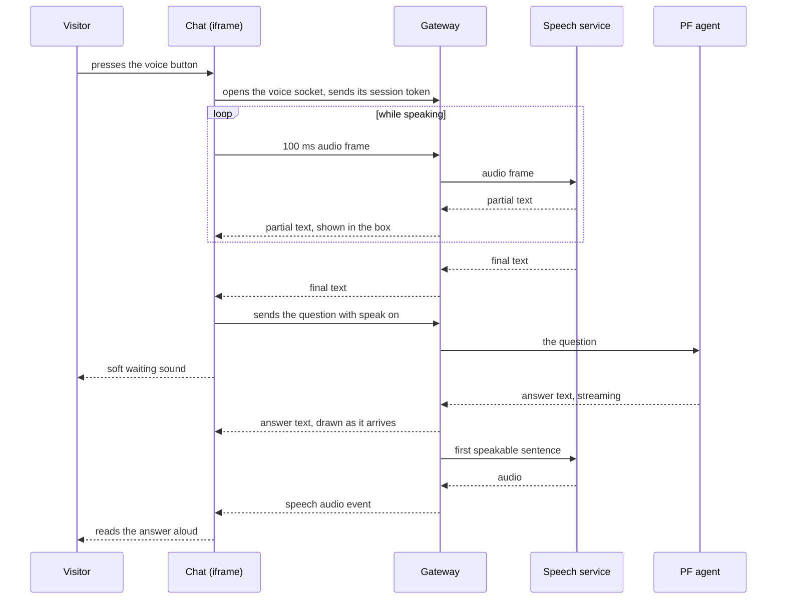

# Voice (M11): design and exploration

Status: proposal, 19 November 2026. It answers M11-T1 (the provider path) and sets out how M11-T2 to T5 are built. Research on browsers and speech services was done on 19 November 2026; facts that could not be confirmed are marked.

## 1. What the visitor gets

- **Dictation.** A microphone button in the composer. The visitor speaks, the words appear in the question box as they speak, and they press Send as usual. This is M11-T2: the visitor confirms before anything is sent.
- **Voice conversation.** A second button starts a hands-free loop:
  - The visitor speaks, and the question is sent when they stop.
  - The answer appears in the chat as text, and is read aloud sentence by sentence as it streams.
  - When the reading ends, the chat listens again.
  - Play, pause and stop are always on screen (M11-T3). A tap stops the reading at once.
- **Text always.** Every spoken question and answer is also in the chat as text, so nothing is available only by voice. Every voice control works by keyboard.

## 2. What shapes the design

| Fact | Consequence |
|---|---|
| PF takes and returns text only; it has no speech service (confirmed by you, 19 November). | Speech-to-text runs before PF and text-to-speech after it, outside PF. Our gateway sits between them already, so it orchestrates both. |
| PF takes 2 to 5 seconds to its first word. Short answers arrive all at once; long ones stream at about 260 characters a second (`pf-capability-sheet.md` section 6). | PF's wait is most of the delay, and nothing we build shortens it. We keep our own share small and make the wait audible. PF streams about 17 times faster than speech (about 15 characters a second), so once the first sentence is ready, reading never runs dry. |
| Nothing about PF reaches the browser (R13). | Unchanged: speech travels between the browser and our gateway only. |
| UK customers want personal data processed in the UK (T19). | A voice is personal data. The speech service must process audio in London and keep nothing. |
| The chat runs in a cross-origin iframe under a strict content policy (`default-src 'none'`). | The host page must grant the microphone to our frame. The policy already allows what voice needs (section 8). |
| The first load is held under 100 KB compressed. | All voice code loads on the first press of a voice button, as one chunk of 60 KB or less. |

## 3. Where the time goes

From the moment the visitor stops speaking to the first sound of the answer:

| Step | Push to talk | Hands-free | Who |
|---|---|---|---|
| Knowing they have finished | 0 (they let go) | 0.6 to 0.8 s of silence | us |
| The last words recognised | about 0.2 to 0.5 s (estimate) | included above | speech service |
| The gateway asks PF | at most 150 ms (M4's budget) | same | us |
| PF's first word | 2 to 5 s | same | PF |
| The first sentence becomes sound | about 0.2 to 0.4 s (estimate) | same | speech service |
| **Total** | **about 2.5 to 6 s** | **about 3 to 6.5 s** | |

Voice products aim for about 0.5 s and accept up to 1.5 s (Voice AI primer, June 2026). PF alone takes longer than that. So:

- **Our share stays under about 1 second.** This is measured and logged per answer, like the gateway's share of the first word today.
- **The wait is audible.** A soft sound plays from the moment the question is sent until the first word arrives, so silence never reads as failure.
- **The first piece read is short.** The first sentence, or the first clause of 60 characters or more, is read alone. After that, sentences are joined into pieces of up to about 250 characters.
- **Nothing is set up after the visitor speaks.** The microphone, the audio output and the connection to the gateway are prepared on the button press, which also satisfies iPhone's rule that audio starts from a tap.
- **Later, if measured worthwhile:** create the PF conversation when listening starts, since a new chat's first question pays for creating it.

## 4. The provider path (M11-T1)

Speech-to-text and text-to-speech are separate, each behind a small interface with a fake for tests (D4):

- `Listener`: audio frames in, partial and final text out.
- `Speaker`: text in, audio out.

Two kinds of engine sit behind them.

### 4.1 Chrome's own recognition, the "Chromium" path

Browsers have a built-in recogniser, `SpeechRecognition`:

- **Where the audio goes.**
  - By default, Chrome streams the audio to Google, with no published retention terms and no choice of region.
  - Since Chrome 139 (August 2025), it can recognise **on the device** (`processLocally`), so the audio never leaves the computer.
  - On-device recognition works only on desktop Chrome (Windows, macOS, Linux), not on Android or ChromeOS.
  - Each language needs a download of about 60 MB. Whether en-GB is offered is not confirmed.
- **Edge:** on-device recognition only in preview builds, and not in en-GB.
- **Safari:** sends audio to Apple, with the `webkit` prefix. Continuous listening is unreliable on iPhone.
- **Firefox:** has no recogniser today. Mozilla plans an on-device-only one for desktop in Firefox 161.
- **Inside our frame,** the host page must grant `microphone`, and `on-device-speech-recognition` for the on-device mode.

So the browser's recogniser cannot be the main path: it is missing on Firefox and in app web views, and in its default mode it sends UK visitors' voices to Google or Apple on unknown terms. It is still worth having where it is safe:

- **On the device** (default `on_device`): used when Chrome says the language is installed. There is no network, no cost and no residency question. Otherwise the cloud path is used.
- **Anywhere** (`allowed`): an administrator may also allow the browser maker's own cloud. This suits a demo with no speech service set up. The console says plainly where the audio goes.
- **Never** (`never`).

Spoken replies through the browser's own voices (`speechSynthesis`) are the fallback when no speech service is set up. They are free and instant, but their quality depends on the device. Chrome cuts off speech after about 15 seconds, so they are fed one sentence at a time, as the cloud path is.

### 4.2 A cloud speech service, through our gateway

This works in every supported browser:

- **Listening.** The chat records 16 kHz 16-bit mono audio with an AudioWorklet. It sends 100 ms frames (3,200 bytes) over a WebSocket to the gateway. The gateway streams them to the speech service and returns partial and final text.
- **Speaking.**
  - A question sent with `speak: true` makes the gateway read the answer aloud as it streams. Its speakable text is cut into pieces, each piece is synthesised (two ahead at most), and the audio comes back in the answer's own stream as `speech.audio` events, in order. The chat plays them through Web Audio.
  - Because the gateway reads only its own agent's answers, it can never become a free text-to-speech service for anyone who calls it.
  - A failure to speak is logged and leaves the text answer untouched.

### 4.3 Which cloud

| | Azure AI Speech, UK South | AWS Transcribe and Polly, London | Google Cloud | Deepgram |
|---|---|---|---|---|
| Processed in London | Yes, both | Yes, both | Text-to-speech yes; speech-to-text (Chirp 3) only in the EU or US multi-regions | EU endpoint, no UK |
| Audio and text kept by default | No: real-time audio stays in server memory; prebuilt voices keep neither text nor audio | **Yes: kept and used to improve the service** unless the AWS Organization sets an AI opt-out policy | Speech-to-text not logged unless opted in; text-to-speech not checked | Opt out on every request |
| Default limits | 100 concurrent recognitions; 30 syntheses a second (up to 1,000 on request) | 25 concurrent streams; Polly neural 8 a second | 300 concurrent streams | 150 concurrent streams |
| Price | about $1 an hour to recognise; about $16 a million characters to speak (third-party figures) | $0.01 a minute to recognise (US price, 2026); $16 a million characters neural | $0.016 a minute; Chirp 3 HD voices $30 a million | $0.0048 a minute |
| What it needs from us | A Speech resource in UK South and its key in Secrets Manager | An AWS administrator to add `transcribe:` and `polly:` to the `ucp-dev-boundary` permissions boundary and the task role, plus the Organization's AI opt-out policy | A GCP project, gRPC libraries | A new supplier |
| Calling it from Python | Speech SDK (native, adds two system libraries to the image); text-to-speech is a plain HTTPS call | Our own SigV4 signing and AWS event-stream framing (about 100 lines; no AWS library, as decided on 14 November); Polly is one signed HTTPS call per piece | `google-cloud-speech` (gRPC) | WebSocket, no library |
| Latency | not published | not published | not published | about 0.06 s after speech ends (independent benchmark) |

**Recommendation: Azure AI Speech in UK South**, for both directions:

- It is the only option that keeps audio in London and stores nothing, without a policy change at organisation level.
- Its limits are four times AWS's.
- It needs no change from an AWS administrator. Its key goes into Secrets Manager under `ucp-dev/`, which the boundary already allows.
- Azure is also the next cloud in our plan (section 11 of the breakdown).

The cost is a second supplier beside AWS. AWS is the alternative if one supplier matters more: the adapter is the same size, but it waits for the two administrator changes. Whichever is chosen, the provider's region is set to match each deployment's region (dev: the provider's nearest region to us-east-1; production: London).

## 5. How it runs

The text path is unchanged: the question goes through today's endpoint and its answer streams as today. Voice adds the socket in front and the audio events alongside.

### 5.1 What other modules depend on

- **Public settings (`WidgetConfig`):**
  - `voice_enabled` (off by default, R11);
  - `voice_language` (BCP 47, default `en-GB`);
  - `browser_speech`: `never`, `on_device` (default) or `allowed`.

  The console's Look station gets the three, beside the attachments switch. Which cloud is used is a server setting, never sent to the browser.
- **Asking with voice:** `SendMessage.speak: bool`, default false.
- **The answer's stream:** a new event `speech.audio`, carrying `{index, text, audio}`. `audio` is base64 MP3 at 24 kHz and 48 kbit/s, which every supported browser decodes, about 8 KB a second of speech after base64. Chats that do not know the event ignore it.
- **The voice socket, `GET /v1/voice` (WebSocket):**
  - The token goes in the first message, `{"type": "start", "token", "language"}`, and never in the address, so it stays out of logs.
  - Then binary frames of audio, then `{"type": "stop"}`.
  - The gateway answers with `partial`, `final` or `error`. `error` carries the usual `ApiError`, so the problem kinds in the chat stay as they are.
  - The socket must come from our own origin; anything else is refused before it opens.
- **The loader:** `iframe.allow` gains `microphone` and `on-device-speech-recognition`, only when the widget has voice switched on.
- **Consent:** a `voice_consents` table (migration 0012) records the visitor, the widget, the time and the version of the notice they accepted.

### 5.2 Speakable text

Answers are Markdown with tables, code, charts and diagrams. They are read aloud from a speakable version:

- Headings, paragraphs and list items are read as sentences.
- Emphasis marks are dropped, and links are read by their words.
- A table, a code block, a chart, a diagram or a formula is not read out. It is replaced by one short sentence, such as "There is a table in the chat."

## 6. Scaling

**Load on the gateway:**

| | Per visitor | 100 visitors at once |
|---|---|---|
| Listening (up only) | 32 KB/s of audio, 10 frames a second | 3.2 MB/s, 1,000 frames a second |
| Speaking (down only) | about 8 KB/s, one event per piece | about 0.8 MB/s |

- Forwarding frames is network work, not computing work. One gateway task (1 vCPU) handles it alongside text chat.
- Frames are 100 ms, not 20 ms, so the Python loop handles five times fewer messages. This adds at most 0.1 s.
- Visitors hold the socket only while the microphone is open.

**How many visitors listen at once.** At 1,000 spoken questions an hour, each about 8 seconds long, about 2 visitors are listening at any moment. At 20,000 an hour, about 44 are. The speech service's limits (100 concurrent recognitions on Azure, 25 on AWS) bind long before the gateway does. Raise them before a large customer goes live.

**Limits we enforce, as for text (M12-T4):**
- one socket per session;
- at most 60 seconds per utterance;
- frames of at most 6,400 bytes;
- at most 50 KB/s;
- concurrent listeners per tenant, like `Turns.admit` today;
- a daily allowance of minutes per widget, counted in PostgreSQL like the text quotas.

When the speech service is full or down, the chat says so and the visitor can type. The circuit breaker used for PF is reused per speech service.

**Releases and draining:**
- The gateway's target already drains for 120 seconds, longer than the 60-second utterance limit, so a release does not cut anyone off mid-sentence.
- A socket that drops ends listening, and the visitor keeps what was heard so far.
- Sockets send a ping every 15 seconds, well inside the 60-second CloudFront and 120-second load balancer idle limits. Both carry WebSockets as they are.

**Growing:**
- **First,** voice runs inside the gateway service.
- **When voice traffic is large enough to matter,** the same image runs as a separate ECS service. The load balancer sends it `/v1/voice` by path, so it scales and releases on its own. It scales on active connections, which needs the autoscaling permissions still waiting on an AWS administrator.
- **WebSocket, not WebRTC.** WebRTC is the usual choice for full-duplex voice with interruption over poor mobile networks. It needs relay (TURN) servers and UDP, which our CloudFront and load balancer do not carry. Utterances here are short and one way at a time, so a WebSocket is enough. WebRTC is reconsidered only if interrupting by voice (barge-in) becomes a requirement.

**Cost, at Azure's third-party prices:**
- **A college-sized load,** 500 spoken questions a day: 8 seconds each is about 67 minutes a day, about $1.10 to recognise. Answers read at 500 characters each are 250,000 characters a day, about $4. That is roughly $150 a month.
- **The browser's own engines** cost nothing.

## 7. Security, privacy and consent

- **No audio is kept.**
  - The gateway holds frames in memory only while forwarding them, and writes no audio anywhere: no table, file or log.
  - Recognised text becomes the question, which is stored as any typed question is.
  - The recommended service keeps nothing.
  - M11-T4's "unless configured" is left for later: there is no setting to keep audio.
- **Consent before the first recording.**
  - A short notice appears the first time a visitor presses a voice button. It says what happens to their voice, and which company processes it when that is the browser maker.
  - Continue records the consent; Cancel leaves the chat as it was.
  - The browser's own microphone prompt follows. A refusal there is explained in the chat, with how to allow it.
- **Listening stops when the page is hidden.** Visitors are never recorded from a background tab.
- **New threat-model entry, T23: a visitor's voice is kept, sent abroad, or the voice route is abused.** Its mitigations are the points above plus:
  - the same-origin check on the socket;
  - the token in the first message;
  - the limits in section 6;
  - text-to-speech only for the agent's own answers;
  - the provider's region pinned to the deployment's.

## 8. In the browser

- **The host page.** Our loader asks for the microphone on the frame. A host whose own `Permissions-Policy` header restricts the microphone must add our origin to it, for example `Permissions-Policy: microphone=(self "https://chat.example")`. M11-T5 documents this in the integration guide, beside the content-policy line.
- **Prompts.** In Chrome, the microphone prompt names the host site, since our frame borrows the host's permission. Safari asks on each visit.
- **Our content policy needs no change:**
  - the socket is our own origin (`connect-src 'self'`; this covers `wss:` in current browsers, to be confirmed on all three engines in the tests);
  - the AudioWorklet is a script file of our own (`script-src 'self'`);
  - the audio is decoded into Web Audio, never loaded from an address.
- **iPhone.** The audio output is unlocked on the button press. Recognition through Safari's own engine is push-to-talk only, as its continuous mode is unreliable.
- **No microphone, or a refusal.** The buttons say why when pressed, and typing is unaffected.

## 9. Tasks and order

Feature branches into `module/m11-voice`. Everything up to task 4 is built and tested here against a fake speech service, so no AWS resource is woken.

| # | Branch | What | Tests |
|---|---|---|---|
| 1 | `feature/m11-voice-contract` | The settings, `speak`, the `speech.audio` event and the socket messages in the message format; the console switches; the loader's `allow` | Protocol examples; console unit test; loader unit test that `allow` follows the switch |
| 2 | `feature/m11-voice-gateway` | `ucp/speech.py` with the two interfaces and a fake; the voice socket with its limits, quota and consent table; speaking answers in `Turns`; speakable text | Unit: speakable text, piece-cutting. Backend: size, length, rate and format limits, origin and token, quota, consent. Integration: a turn with `speak` streams text and audio in order; a speech failure leaves the text whole; no audio written anywhere |
| 3 | `feature/m11-voice-chat` | The two buttons, consent notice, listening and speaking states, play, pause and stop; the AudioWorklet and Web Audio queue; the browser's own engines with the on-device check | Unit: recording and playback states. UI: permission granted, denied and withdrawn; no microphone; page hidden; keyboard only; phone width. End to end on Chromium with a recorded question as the fake microphone (`--use-file-for-fake-audio-capture`): speak, confirm, send, hear the reply. Accessibility scan |
| 4 | `feature/m11-voice-provider` | The chosen service's adapter; Terraform for its secret and region (applied only when you next wake dev) | Integration against the real service: an en-GB recording transcribes, and synthesised audio decodes. Gated like the PF staging test |
| 5 | `feature/m11-voice-docs` | This document kept current; the host permission guide (T5); threat model T23; the browser matrix; `DESIGN.md`; the breakdown | |

**Left for later:**
- interrupting the reading by voice (a tap stops it now);
- WebRTC;
- keeping audio on request (T4's "unless configured");
- choosing the voice per widget (a British neural voice is used for now);
- languages beyond English in the chat's own words. The voice language is already a setting.
- reading text into the speech service as it streams, rather than piece by piece (Azure's text-streaming mode, Polly's bidirectional mode);
- real-device passes on iPhone and Android, with the rest of real-device testing before production.

## 10. Sources

- Chrome 139 release notes (on-device speech recognition): https://developer.chrome.com/release-notes/139
- On-device recognition platforms, blink-dev, May 2026: https://groups.google.com/a/chromium.org/g/blink-dev/c/cD_-fohuHrs
- Web Speech API on MDN: https://developer.mozilla.org/docs/Web/API/Web_Speech_API/Using_the_Web_Speech_API
- Edge's recognition: https://learn.microsoft.com/en-us/microsoft-edge/web-platform/speech-recognition-api
- Browser support: https://caniuse.com/speech-recognition and https://caniuse.com/speech-synthesis
- Firefox's plan, October 2026: https://groups.google.com/a/mozilla.org/g/dev-platform/c/6f4l8P9hO6o
- Azure Speech regions: https://learn.microsoft.com/en-us/azure/ai-services/speech-service/regions
- Azure Speech limits: https://learn.microsoft.com/en-us/azure/ai-services/speech-service/speech-services-quotas-and-limits
- Azure speech-to-text data: https://learn.microsoft.com/legal/cognitive-services/speech-service/speech-to-text/data-privacy-security
- Azure text-to-speech data: https://learn.microsoft.com/en-us/legal/cognitive-services/speech-service/text-to-speech/data-privacy-security
- Azure synthesis latency: https://learn.microsoft.com/en-us/azure/ai-services/speech-service/how-to-lower-speech-synthesis-latency
- AWS Transcribe opt-out: https://docs.aws.amazon.com/transcribe/latest/dg/opt-out.html
- AWS Transcribe streaming: https://docs.aws.amazon.com/transcribe/latest/dg/streaming-setting-up.html
- AWS Transcribe pricing: https://aws.amazon.com/transcribe/pricing/
- Polly limits: https://docs.aws.amazon.com/polly/latest/dg/limits.html
- Polly bidirectional streaming: https://docs.aws.amazon.com/polly/latest/dg/bidirectional-streaming.html
- Google Chirp 3: https://docs.cloud.google.com/speech-to-text/docs/models/chirp-3
- Google speech-to-text limits: https://docs.cloud.google.com/speech-to-text/docs/quotas
- Deepgram regions: https://developers.deepgram.com/reference/regional-endpoints
- Streaming speech-to-text benchmark, June 2026: https://www.artificialanalysis.ai/articles/new-streaming-speech-to-text-benchmark-aa-wer-streaming
- Voice AI primer, June 2026: https://voiceaiandvoiceagents.com/
