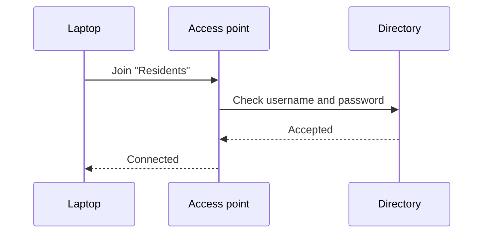

## Connecting to the residents' network

Run this to check your connection:

```python
import socket

def online(host="example.org", port=443, timeout=3):
    try:
        socket.create_connection((host, port), timeout=timeout).close()
        return True
    except OSError:
        return False
```

A long line scrolls sideways instead of wrapping:

```javascript
const settings = { network: "Residents", security: "WPA2-Enterprise", identity: "your-college-username@example.org", certificate: "Use system certificates", domain: "example.org" };
```

A fence with no language:

```
ssid: Residents
eap: PEAP
phase2: MSCHAPV2
```

An indented block:

    ping -c 4 example.org

A fence made of tildes, tagged with an unusual language:

~~~c++
int main() { return 0; }
~~~

How the sign-in works:


