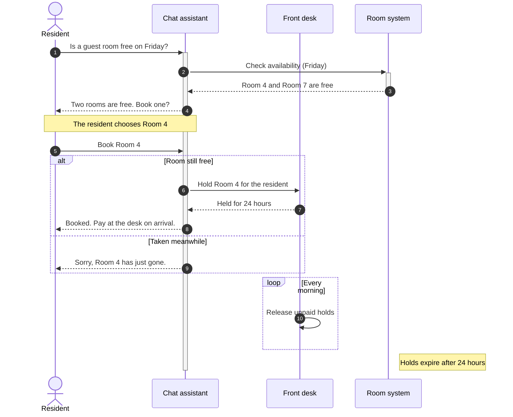
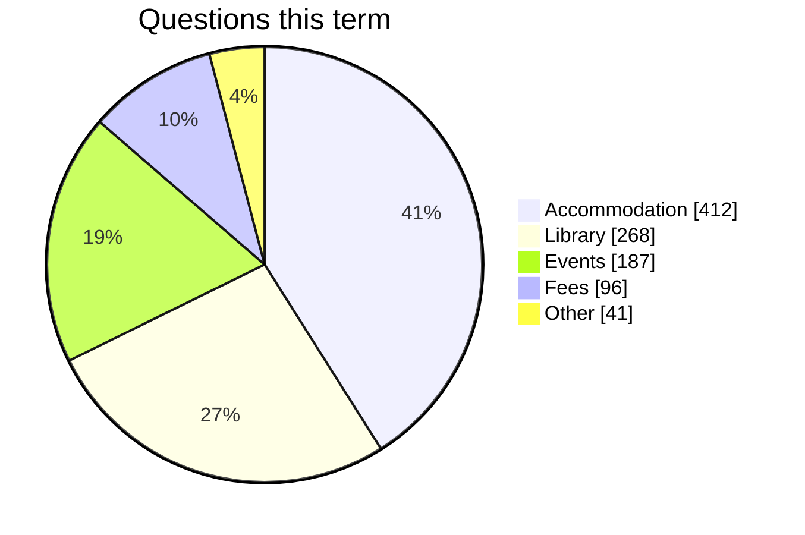
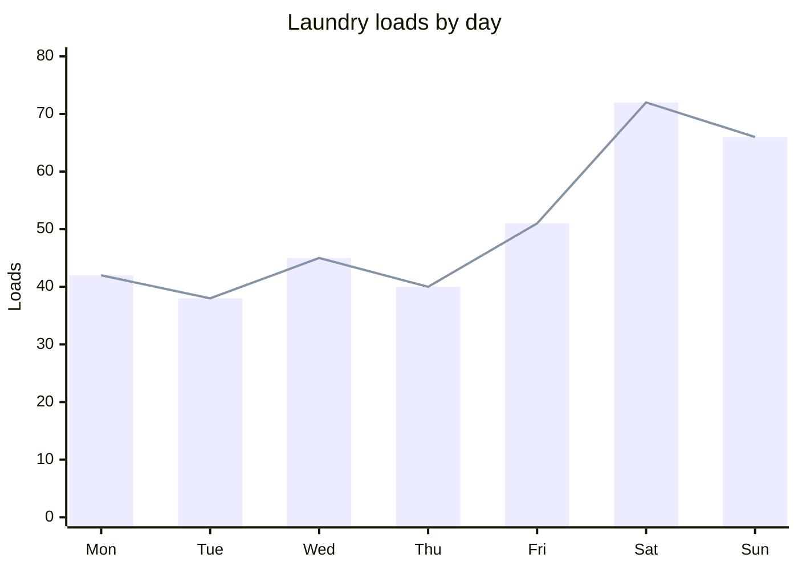
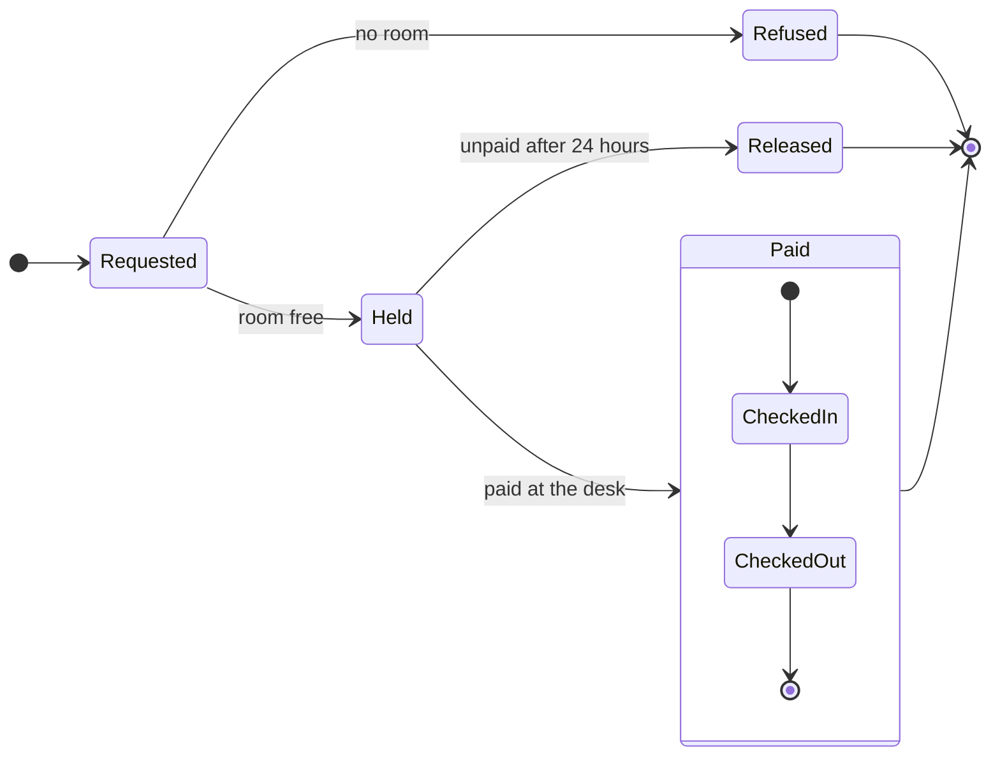
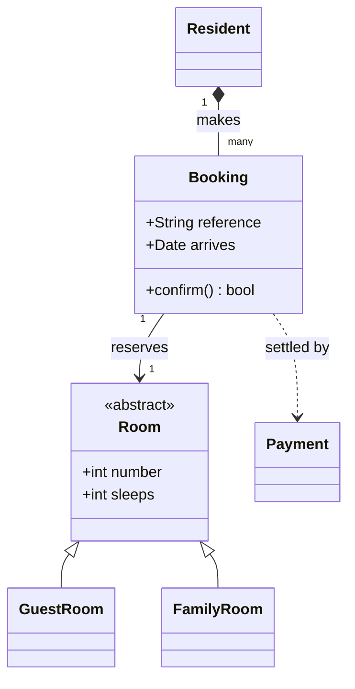
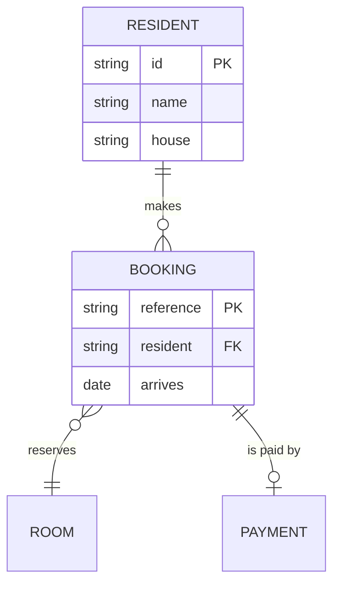
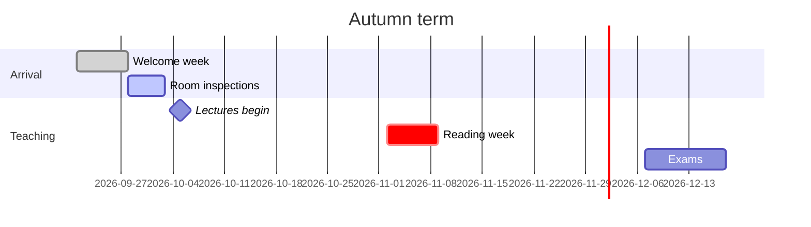
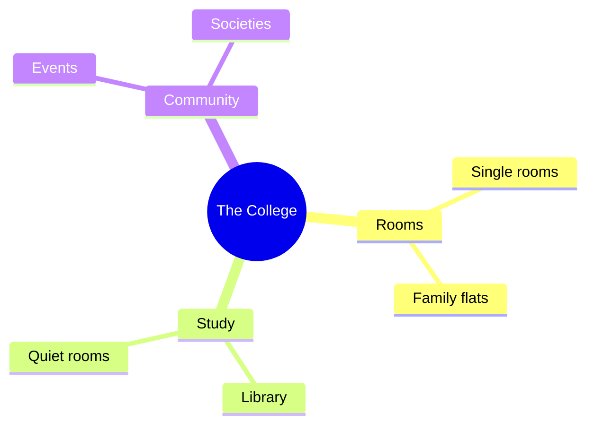
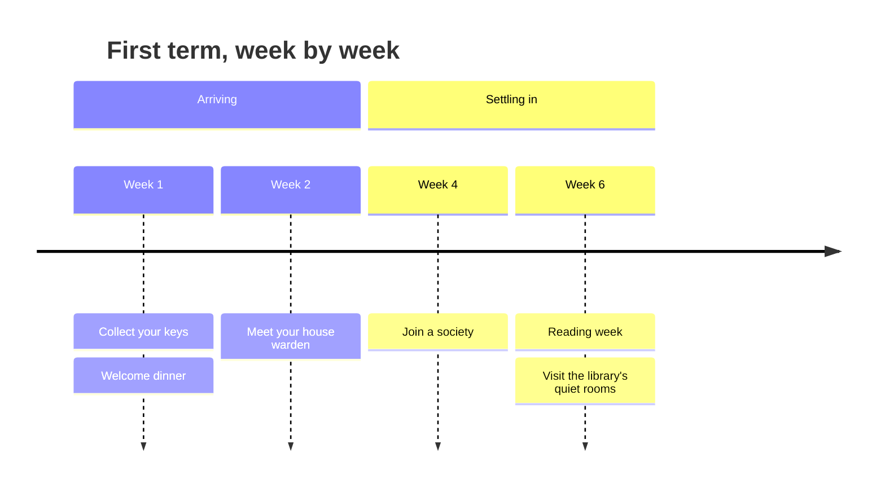
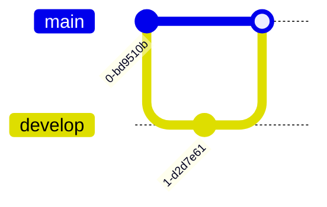

## Booking a guest room

How a resident's booking travels through the College's systems:

## Where the questions come from

## Laundry use through the week

## A guest room booking's states

## The booking system's classes

## Residents, rooms and payments

## Term plan

## What the College offers

## A resident's first term

## Kinds Mermaid can draw that the chat shows as code

